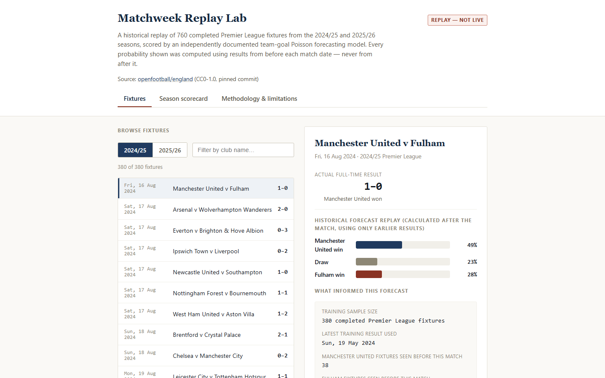

# Matchweek Intelligence — the Matchweek Replay Lab

A historical, honestly-labelled replay of a simple Premier League forecasting model against
760 real, completed 2024/25 and 2025/26 fixtures. Nothing in this repository predicts a real,
upcoming match. Every probability shown is a retrospective simulation — "what would a model
fit only on results from before date X have said about fixtures on or after date X" — using
match dates, not a validated precise kickoff timestamp, so no forecast here was or could have
been issued before a match was actually played.

**Live demo:** _pending — not yet deployed publicly._

## What this is

Pick any one of the 760 evaluated fixtures from 2024/25 or 2025/26 and see exactly what this
project's single frozen model (`team_goal_poisson`) would have said about it, using only
results dated before that match — next to the actual final score, a season-level scorecard
(log loss, Brier score, ranked probability score, draw calibration), and a comparison against
two simpler baselines showing why the team-specific model was adopted.



### How to interpret a fixture

Manchester United v Fulham, 16 August 2024 — the earliest fixture in the dataset. Before this
match, the model had seen 380 prior Premier League results (all from 2023/24 and earlier in
2024/25, the latest dated 19 May 2024). Based only on that history, it gave:

| Outcome | Probability |
| --- | --- |
| Manchester United win | 48.5% |
| Draw | 23.2% |
| Fulham win | 28.2% |

The actual result was 1–0 to Manchester United — the most likely outcome the model assigned,
but far from a certainty, which is the point: a well-calibrated forecast on an inherently
uncertain, roughly-even-odds sport should get its *most likely* outcome right somewhat more
often than chance, not every time.

### Why `team_goal_poisson`

Three predeclared baselines were backtested on the identical 760 fixtures (lower log loss is
better):

| Model | Log loss (760 fixtures) |
| --- | --- |
| Expanding league prior (no team identity at all) | 1.0833 |
| League-only Poisson (goals, no team identity) | 1.0817 |
| **Team-goal Poisson (adopted default)** | **1.0147** |

A fourth, more complex Dixon-Coles challenger was also evaluated and showed a small further
improvement, but its descriptive bootstrap interval straddled zero in every scope tested — not
strong enough evidence to adopt the added complexity. It remains evaluated, not adopted; see
the in-app Methodology page for the full discussion.

### What this is not

- Not a live or current-season forecasting product — there is no 2026/27 prediction anywhere,
  and `live_claim_allowed` is hard-coded `false` throughout the pipeline and independently
  re-checked in the browser.
- Not a betting or tipping tool — no odds, no "value bet" framing, no stake sizing.
- Not a claim that any forecast existed before its match was played. The model's training
  cutoff is strictly before each fixture's match date, but the probabilities themselves were
  computed in a single retrospective study, after all 760 results already existed, during
  2024/25 and 2025/26 — two seasons this project's own methods were repeatedly inspected
  against while being built. That is disclosed explicitly on the in-app Methodology page, not
  presented as a blind, pristine test.

## Setup — Python (forecasting pipeline and data generator)

```
uv sync
uv run pytest -q -rs
```

Console scripts may be blocked by Windows Application Control policy; if so, use
`uv run python -m matchweek_intelligence.<module>` instead.

## Setup — web (Matchweek Replay Lab)

```
cd web
npm ci
npm run typecheck
npm run lint
npm run test
npm run build
npm run preview -- --host 127.0.0.1 --port 4173
```

The preview serves the static production build from `web/dist/` with no Python backend and no
raw source cache required — it reads only the already-generated, tracked
`web/public/data/replays.json`. To regenerate that file from the pinned source cache, run
`uv run python -m matchweek_intelligence.build_public_replay_data` from the repository root.

## Further reading

- **Methodology, limitations, and the "why not Dixon-Coles" discussion:** in-app Methodology
  page, or `docs/S03_BASELINE_METHODS.md` / `reports/S04_ATTRIBUTION_AUDIT.md` /
  `reports/S05_DIXON_COLES_EVALUATION.md`.
- **Source rights and provenance:** `docs/SOURCE_RIGHTS_AND_PROVENANCE.md`.
- **Licensing:** see below.

## Licensing — three separate things, three separate licences

1. **Upstream source data** (`openfootball/england`, pinned commit
   `9ee7a0c351805c99cc334478a9bf04b7d0432fec`): **CC0-1.0**, granted by the upstream
   maintainer at *their own* repository root
   (<https://github.com/openfootball/england/blob/9ee7a0c351805c99cc334478a9bf04b7d0432fec/LICENSE.md>).
2. **This project's own original code** (the Python pipeline and the React/TypeScript web
   app): **MIT**, see the root [`LICENSE.md`](LICENSE.md).
3. **This project's own derived, published research dataset**
   (`web/public/data/replays.json`, the `reports/` audit JSON files): **CC0-1.0**, dedicated
   separately and explicitly — see [`docs/DERIVED_DATA_LICENCE.md`](docs/DERIVED_DATA_LICENCE.md).

A CC0 data release does not make the code that produces it CC0, and an MIT-licensed codebase
does not make its output data MIT — each is licensed on its own terms, stated separately in
the app's own footer as well as here.

## Research history

This product was built slice by slice, each with its own tracked audit trail:

- **S01 — source rights and freshness audit.** `openfootball/england` accepted as a CC0,
  pinned-commit data source. `docs/SOURCE_RIGHTS_AND_PROVENANCE.md`,
  `reports/S01_SOURCE_DECISION.md`.
- **S02 — verified three-season historical corpus.** 2023/24, 2024/25 and 2025/26 Premier
  League seasons (380 fixtures each, 1,140 total) independently validated: exact fixture
  counts, full 20-team double round-robin structural check, score integrity, canonical
  team-identity mapping, calendar-window checks. 2026/27 remains excluded — current and
  partial, never a historical candidate. `docs/DATA_CONTRACT.md`,
  `docs/BACKTEST_INPUT_CONTRACT.md`, `reports/S02_HISTORICAL_CORPUS_AUDIT.md`.
- **S03 — chronological forecasting baselines.** Three predeclared, simple statistical
  baselines (expanding league prior, rolling league frequency, independent team-goal Poisson)
  backtested out-of-time against the 760 held-out 2024/25 + 2025/26 fixtures, using 2023/24 as
  training-only history. `docs/S03_BASELINE_METHODS.md`, `reports/S03_BASELINE_BACKTEST.md`.
- **S04 — attribution and calibration audit.** A fourth, league-only Poisson baseline added to
  decompose where `team_goal_poisson`'s gain comes from; draw-calibration diagnostics across
  both evaluated seasons. `reports/S04_ATTRIBUTION_AUDIT.md`,
  `reports/s04_calibration_diagnostics.json`.
- **S05 — one specified-protocol Dixon-Coles challenger, evaluated and not adopted.** A single
  low-score-correlation challenger (`dixon_coles_team_poisson`), frozen before its result was
  computed, scored against all 760 fixtures. Its point estimate was slightly better than the
  frozen `team_goal_poisson` default, but the descriptive bootstrap interval straddled zero in
  every scope — reported honestly as not strong enough evidence to switch.
  `docs/S05_DIXON_COLES_PROTOCOL.md`, `reports/S05_DIXON_COLES_EVALUATION.md`.
- **S06 — Matchweek Replay Lab: public-data contract and first functional local product.**
  Closed three reproduced review issues from S05 (a backwards bootstrap-sign interpretation
  string, a cross-model fixture/season consistency gap, and a Dixon-Coles zero-boundary
  positivity edge case); built a deterministic public JSON fixture-replay dataset and a static
  local web preview.
- **S07 — browser-verified product QA and release-readiness review.** Fixed a route/filter
  integrity bug (a selected fixture could display under a contradictory season or club
  filter), added runtime validation of the fetched public dataset in the browser itself (a
  second, independent trust boundary beyond the Python generator), fixed a desktop/mobile
  usability issue (the selected fixture's forecast could sit off-screen below a long fixture
  list), and corrected a second, previously-deferred copy of the S05/S06 bootstrap
  sign-interpretation bug with a dedicated erratum
  (`reports/S07_S04_INTERPRETATION_ERRATUM.md`) and zero numeric drift. Verified with real
  browser automation (Chrome via Playwright), not jsdom alone.
- **S08 — public release candidate.** Corrected a factually wrong UI timing claim ("Pre-match
  forecast (computed before this result existed)" — the probabilities were computed
  retrospectively, after results existed, using only earlier-dated results in training);
  closed three browser-validator fail-open gaps an independent reviewer demonstrated with
  synthetic adversarial mutations; added the additive `benchmark_scorecards` three-model
  comparison above (`schema_version` 1.0.0 → 1.1.0), with zero change to the existing
  fixtures/season-scorecard data; resolved dependency-security findings (`npm audit`: 12 → 0,
  via a verified major Vite/Vitest upgrade); and settled the licensing above with explicit,
  separate choices for code and derived data.

## What remains out of scope

- `dixon_coles_team_poisson` is evaluated but **not adopted** as the default — `team_goal_poisson`
  remains the default, and no further challenger model is planned without a genuinely
  prospective (not hindsight-informed) test.
- No live or current-season (2026/27) forecast of any kind. `live_claim_allowed` is
  hard-coded `False` in `build_data_quality.py`; nothing in this repository can override it.
- No tactical narrative, no betting advice, no market-anchored pricing.
